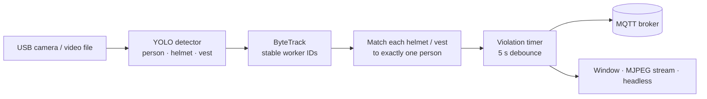

# 🦺 Safety Warning: PPE Monitoring on the Edge

Real-time detection of workers who are missing a **hard hat** or a **high-visibility vest**, running on a **Raspberry Pi 5** and sending alerts over **MQTT**.

Final project of the **Samsung Innovation Campus** program.


## How it works



1. **Detection**: a custom-trained YOLO model with three classes (`person`, `helmet`, `vest`). Weights are shipped as `best.pt` and `best.onnx`.
2. **Tracking**: ByteTrack keeps a stable worker ID. If the tracker loses an ID, the worker is re-matched by distance (within 120 px). Workers not seen for 3 s expire, so a new person never inherits an old ID.
3. **PPE matching**: a helmet counts only inside the top 40% of a person's box, and a vest inside the 20–80% band. Each item is assigned to **one** person, so a single helmet cannot mark a whole group as safe.
4. **Violation logic**: each worker is `SAFE`, `WARNING` (missing PPE) or `VIOLATION` (missing PPE for longer than 5 s, configurable).
5. **Alerts**: MQTT messages are sent **only when a worker's status changes**, plus a telemetry heartbeat every 60 s. Snapshots of violations can be saved.

## Quick start

```bash
pip install ultralytics opencv-python paho-mqtt

cd AI
python src/detect.py                          # camera 0, show a window
python src/detect.py --view stream            # watch at http://<pi-ip>:8090/
python src/detect.py --view none --mqtt       # headless, publish to MQTT
python src/detect.py --source test.mp4 --imgsz 320
```

| Option | Default | Description |
|---|---|---|
| `--source` | `0` | Camera index, video file or image |
| `--conf` | `0.4` | Detection confidence threshold |
| `--imgsz` | `640` | Inference size (use `320` for more FPS on the Pi) |
| `--view` | `window` | `window`, `stream` (MJPEG over HTTP) or `none` |
| `--violation-seconds` | `5.0` | Time without PPE before a violation is raised |
| `--mqtt`, `--broker`, `--broker-port` | off, `localhost`, `1883` | MQTT publishing |
| `--device-id` | `EDGE_PI5_01` | Device name used in MQTT topics |
| `--save-snapshots` | off | Save a frame when a violation starts |

A standalone camera server for the dashboard is in `edge/camera_stream.py` (MJPEG on port `8080`).

## MQTT messages

| Topic | When |
|---|---|
| `safety/edge/<device_id>/alert` | A worker's status changes |
| `safety/edge/<device_id>/telemetry` | Every 60 s (FPS, workers in frame, uptime) |

Example alert payload:

```json
{
  "device_id": "EDGE_PI5_01",
  "timestamp": "2026-09-20T16:42:38",
  "worker_id": 1,
  "has_hardhat": false,
  "has_vest": true,
  "status": "VIOLATION",
  "violation_type": "NO_HARDHAT",
  "violation_count": 1,
  "violation_duration": 5.2,
  "image_snapshot": "snapshot_EDGE_PI5_01_20260920_164238_w1.jpg"
}
```

## Project structure

```
AI/
├── models/            best.pt, best.onnx (person / helmet / vest)
├── src/
│   ├── detect.py      main pipeline: detection, tracking, PPE matching, MQTT, streaming
│   ├── violation.py   per-worker violation timer
│   ├── safety.py      simple PPE analyzer (earlier version)
│   └── main.py        first version of the pipeline
└── snapshots/         saved violation frames
edge/
└── camera_stream.py   MJPEG camera server for the web dashboard
mqtt/
└── test_mqtt.py       MQTT subscriber for testing
```
